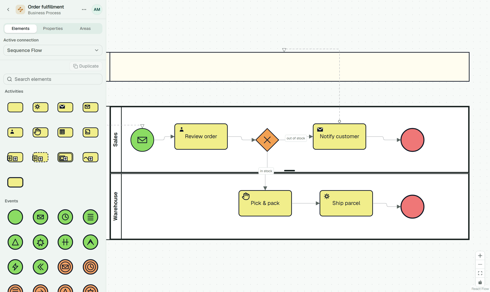
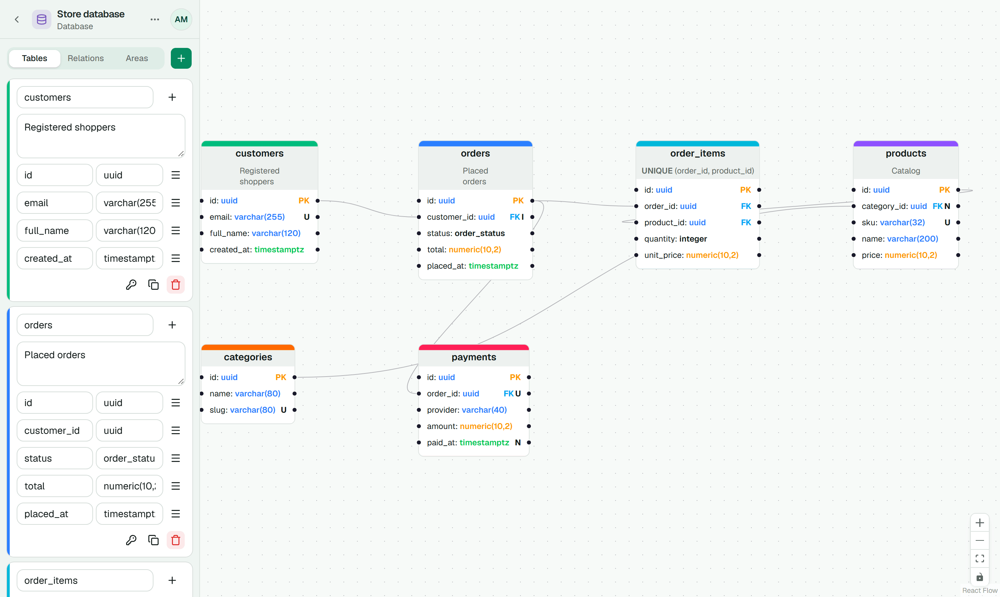
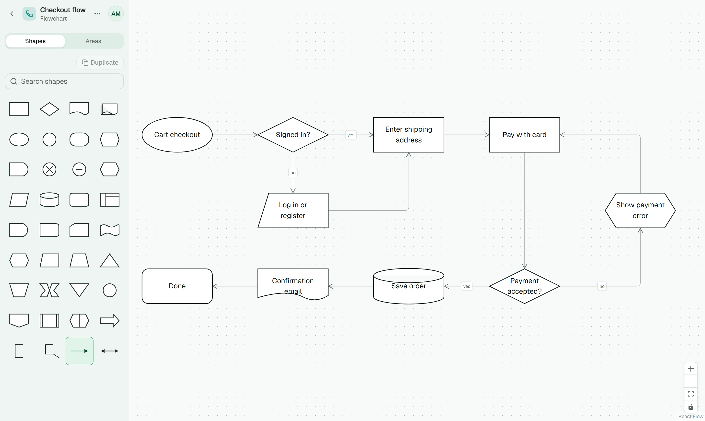
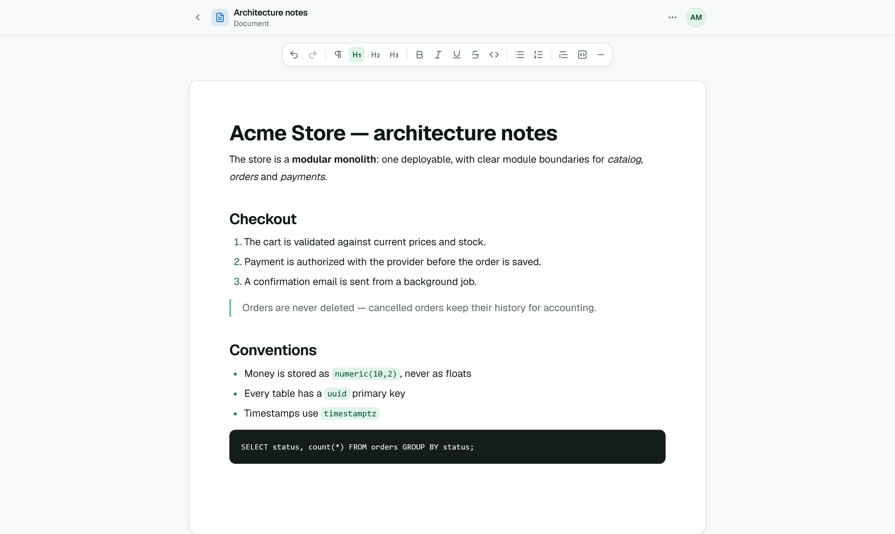
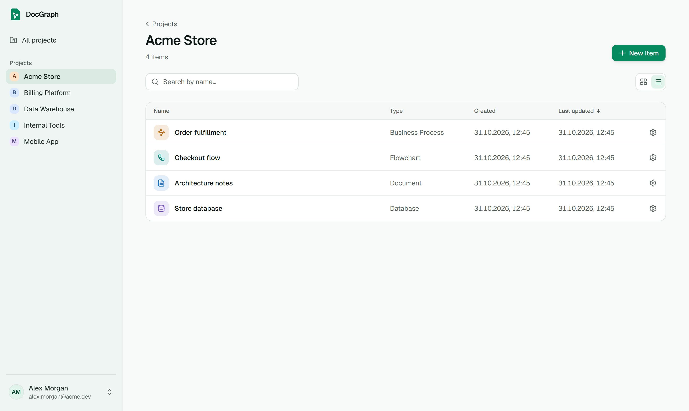

<p align="center">
  
</p>

<h1 align="center">DocGraph</h1>

<p align="center">
  <strong>Your system, mapped in one place.</strong><br />
  A self-hosted, real-time collaborative editor for database diagrams, flowcharts, business process diagrams and documents — with an MCP server so AI coding agents can read and write them too.
</p>

<p align="center">
  <a href="./LICENSE"></a>
  
</p>

<p align="center">
  <a href="#features">Features</a> ·
  <a href="#quick-start-docker">Quick start</a> ·
  <a href="#mcp-for-ai-agents">MCP</a> ·
  <a href="#development">Development</a> ·
  <a href="./CONTRIBUTING.md">Contributing</a>
</p>

<picture>
  <source media="(prefers-color-scheme: dark)" srcset="docs/screenshots/business-process-dark.png" />
  
</picture>

## Features

- **Four editors in one workspace** — database diagrams (tables, typed columns, keys, indexes and relations), flowcharts (30+ standard shapes), business process diagrams in BPMN style (pools, lanes, tasks, events, gateways, message flows) and rich-text documents.
- **Real-time collaboration** — every item is a [Yjs](https://yjs.dev) CRDT document synced over WebSocket, so several people can edit the same diagram or document at once without conflicts.
- **MCP server for AI agents** — coding agents can read a database diagram to write migrations and models, push a schema from code back into a diagram, or draft flowcharts, processes and docs. [More below](#mcp-for-ai-agents).
- **Projects and access control** — group items into projects open to everyone or to selected members; archived projects stay read-only.
- **Import and export** — move diagrams and documents between instances or into other tools, and export diagrams as images.
- **Team-ready auth** — email + password or one-time code login, password reset by email, admin-only invitations and user management.
- **Light and dark themes**, following the system preference by default.
- **Easy to self-host** — one Docker image serves the UI, REST API and WebSocket; the only dependency is PostgreSQL. Migrations run automatically on start.

## Screenshots

<table>
  <tr>
    <td width="50%">
      <picture>
        <source media="(prefers-color-scheme: dark)" srcset="docs/screenshots/database-diagram-dark.png" />
        
      </picture>
      <p align="center"><b>Database diagrams</b> — tables, typed columns, keys and relations</p>
    </td>
    <td width="50%">
      <picture>
        <source media="(prefers-color-scheme: dark)" srcset="docs/screenshots/flowchart-dark.png" />
        
      </picture>
      <p align="center"><b>Flowcharts</b> — standard shapes with a searchable palette</p>
    </td>
  </tr>
  <tr>
    <td width="50%">
      <picture>
        <source media="(prefers-color-scheme: dark)" srcset="docs/screenshots/document-dark.png" />
        
      </picture>
      <p align="center"><b>Documents</b> — collaborative rich text with Markdown import/export</p>
    </td>
    <td width="50%">
      <picture>
        <source media="(prefers-color-scheme: dark)" srcset="docs/screenshots/project-dark.png" />
        
      </picture>
      <p align="center"><b>Projects</b> — every diagram and document of a system in one place</p>
    </td>
  </tr>
</table>

## Quick start (Docker)

The fastest way to try DocGraph is the example Compose file, which pulls the published image (`ghcr.io/jeda777/docgraph`) and starts it next to PostgreSQL:

```sh
git clone https://github.com/Jeda777/docgraph.git
cd docgraph/docker
docker compose -f docker-compose.example.yml up -d
```

Open [http://localhost:3000](http://localhost:3000) and log in with `ADMIN_EMAIL` / `ADMIN_PASSWORD` from the Compose file.

Before exposing it to anyone, edit `docker-compose.example.yml`: set your own `BETTER_AUTH_SECRET`, admin credentials and database password, point `APP_URL` at the public address and fill in the `SMTP_*` settings, which are needed to email one-time codes, invitations and password resets. Without an SMTP server, delete all the `SMTP_*` lines: the codes and links are then written to the server logs. If you leave the example values in, sending fails with `EMAIL_DELIVERY_FAILED`. Running behind a reverse proxy, backups and updates are covered in [docker/README.md](./docker/README.md).

## MCP for AI agents

The server exposes a remote [Model Context Protocol](https://modelcontextprotocol.io) endpoint (Streamable HTTP) at `/mcp`. Agents authenticate with a personal API key sent in the `x-api-key` header. Create one in **Profile → AI agents (MCP)**; the dialog also shows a ready-to-paste command, e.g. for Claude Code:

```sh
claude mcp add --transport http docgraph https://<your-host>/mcp --header "x-api-key: <api-key>"
```

For a project-level config, copy [`.mcp.example.json`](./.mcp.example.json) to `.mcp.json` and set the `DOCGRAPH_API_KEY` environment variable.

A key can be narrowed when it is created: **read-only** (only the reading tools are offered), limited to **selected projects** (each one whole or only selected items) and given an **expiry date** (at most a year ahead). Restrictions never widen access — every call still runs with the key owner's current project permissions, so a key loses a project as soon as its owner does:

| Tool | Purpose |
| --- | --- |
| `list_projects`, `list_items` | Find the item to work with |
| `get_database_schema` | Tables, columns, indexes and relations of a database diagram (no layout) — diagram → code |
| `update_database_schema` | Write tables/relations into a diagram (`merge` or `replace`); tables match by name, so positions and colors are kept — code → diagram |
| `create_database_diagram` | New database diagram, optionally with a schema |
| `get_diagram` | Nodes, edges and areas of a flowchart or business process, with short type names (`process`, `decision`, `activity`, `sequenceFlow`, …) |
| `update_diagram` | Write nodes/edges into a flowchart or business process (`merge` or `replace`, plus `removeNodeIds` / `removeEdgeIds`); nodes match by id, nodes without a position are laid out automatically, and the result is validated against the diagram rules |
| `create_diagram` | New flowchart or business process, optionally with nodes and edges |
| `get_document` | Content of a document as Markdown |
| `update_document` | Write Markdown into a document (`replace` or `append`); unchanged blocks are kept |
| `create_document` | New document, optionally with Markdown content |

Writes go through the collaboration server, so anyone with the item open sees the change live. Archived items stay read-only. Request bodies are limited to 100 MB (`413 PAYLOAD_TOO_LARGE`).

> All screenshots above show content created through these tools.

## Development

### Prerequisites

- Node.js, the version in [`.node-version`](./.node-version) (the workspace enforces it)
- pnpm 12 (`corepack enable` picks the version from `package.json`)
- Docker (local PostgreSQL and Mailpit, server and end-to-end tests, the production image)

### Setup

```sh
git clone https://github.com/Jeda777/docgraph.git
cd docgraph
pnpm install
cp apps/server/.env.example apps/server/.env
```

The example `.env` works out of the box for local development. Then start PostgreSQL and [Mailpit](https://mailpit.axllent.org) (catches outgoing emails, UI on [http://localhost:8025](http://localhost:8025)) and the apps:

```sh
pnpm docker:dev
pnpm dev
```

| Service | URL |
| --- | --- |
| Web app (Vite) | [http://localhost:5173](http://localhost:5173) |
| API server | [http://localhost:3000](http://localhost:3000) |
| React Email preview | [http://localhost:3050](http://localhost:3050) |
| Drizzle Studio | see the turbo output |

The server runs pending migrations and seeds the admin account from `ADMIN_EMAIL` / `ADMIN_PASSWORD` on start — no extra setup steps. Log in at [http://localhost:5173](http://localhost:5173) with those credentials; one-time codes and invitation emails show up in Mailpit.

### Configuration

All server settings are environment variables, read from `apps/server/.env` in development (see [`.env.example`](./apps/server/.env.example)) and from the container environment in production:

| Variable | Description |
| --- | --- |
| `DB_HOST` / `DB_PORT` / `DB_USER` / `DB_PASSWORD` / `DB_NAME` | PostgreSQL connection |
| `DB_SSL` | `false` (default), `true` (TLS with certificate check) or `no-verify` (TLS without the check, for hosts with a private CA) |
| `DB_POOL_MAX` | Max open connections in the PostgreSQL pool (default `20`) |
| `APP_URL` | Public URL of the app (used in emails/links) |
| `PORT` / `HOST` | Address the server listens on (default `3000` / `localhost`) |
| `BETTER_AUTH_SECRET` | Session signing secret, at least 32 random characters (`openssl rand -base64 32`) |
| `ADMIN_EMAIL` / `ADMIN_PASSWORD` | Initial admin account, seeded on start when no admin exists (an existing user with this email is made admin again) |
| `SMTP_*` | SMTP credentials for emails (OTP codes, invitations, password reset); set all of them or none; without any `SMTP_*` var emails are not sent and their login codes and invitation links are logged instead (anyone with log access can use them) |
| `LOG_LEVEL` / `LOG_FORMAT` | Optional: `trace` … `fatal` (default `info`) / `text` or `json` (one JSON object per line) |

### Scripts

| Command | Description |
| --- | --- |
| `pnpm install` | Install dependencies |
| `pnpm docker:dev` | Start PostgreSQL and Mailpit for development (`docker:dev:postgres` / `docker:dev:mailpit` for one of them) |
| `pnpm dev` | Run all apps (server + web + email preview + db studio) |
| `pnpm build` | Build all packages/apps |
| `pnpm check` | Biome check (lint + format + import organizing) — run before committing |
| `pnpm lint` | Biome lint |
| `pnpm format` | Biome format |
| `pnpm test` | Run tests in all packages/apps (the server's need Docker: PostgreSQL in Testcontainers) |
| `pnpm test:e2e` | Run the Playwright end-to-end suite (see [e2e/README.md](./e2e/README.md)) |

Server-only commands: `pnpm --filter server dev`, `pnpm --filter server db:generate` (SQL migration from schema changes), `pnpm --filter server db:studio`, `pnpm --filter server test`.

## Architecture

DocGraph is a pnpm + Turborepo monorepo. Request and response shapes are defined once as Zod schemas in `packages/common`: the server validates input with them and the web app reuses them for forms and typed API hooks. In production the server also serves the built SPA, so a single container handles the UI, the REST API (`/api`), the collaboration WebSocket (`/ws`) and MCP (`/mcp`).

| Layer | Technology |
| --- | --- |
| Frontend | React 19, Vite, Tailwind 4, React Flow, TanStack Query, Zustand, Yjs |
| Backend | Hono REST API, Hocuspocus (Yjs WebSocket), Better Auth, Drizzle ORM + PostgreSQL |
| Shared | Zod schemas (`@docgraph/common/schemas`), diagram logic (`@docgraph/common/diagram`) |
| Tooling | Turborepo, pnpm workspaces, Biome, Lefthook, Vitest, Playwright |
| Production | Docker (multi-stage build, single container) |

| Path | Description |
| --- | --- |
| [`apps/server`](./apps/server) | Hono REST API, Better Auth, Drizzle ORM (PostgreSQL), Hocuspocus CRDT server, MCP endpoint, react-email templates |
| [`apps/web`](./apps/web) | React 19 + Vite SPA |
| [`packages/common`](./packages/common) | Shared Zod schemas for API contracts and diagram logic shared by web and server |
| [`docker`](./docker) | Production Dockerfile, Compose example and nginx example; Compose file for local PostgreSQL and Mailpit |
| [`e2e`](./e2e) | Playwright end-to-end tests (login, editors, live collaboration, MCP) |
| [`.agents`](./.agents) | Step-by-step procedures (skills) for coding agents; conventions live in [AGENTS.md](./AGENTS.md) files |

## Contributing

Contributions are welcome — bug reports, feature ideas and pull requests alike. See [CONTRIBUTING.md](./CONTRIBUTING.md) for the development workflow, conventions and PR process. Please report security issues privately as described in [SECURITY.md](./SECURITY.md).

## License

DocGraph is licensed under the [Apache License 2.0](./LICENSE). You can use, modify, self-host and redistribute it, including in commercial products, as long as you keep the license and copyright notices and mark the files you changed.
